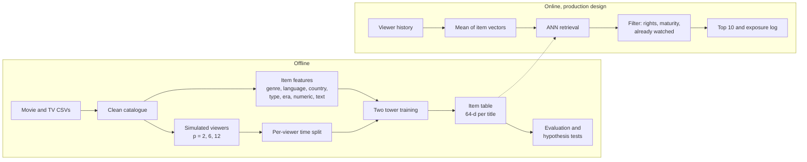

# Two tower recommender for the Netflix catalogue

A two tower deep learning recommender built on the Netflix movies and TV shows
dataset (TMDb metadata up to 2025). The dataset has no viewers, so the project
treats that gap as the main design problem. It simulates viewers from explicit
rules, states two hypotheses before running the final experiment, and tests
them against non-neural baselines with confidence intervals.

1. Hypotheses and decision rules: [`HYPOTHESES.md`](HYPOTHESES.md)
2. Interpretation of the results: [`RESULTS.md`](RESULTS.md)
3. Generated tables: `artifacts/results_summary.md`

All metrics come from simulated viewers. They measure how well a model
recovers the simulator's rules. They are not evidence of quality for real
viewers.

## 1. Problem framing and architecture

The task is retrieval: given a viewer's watch history, return 10 titles they
are likely to watch next. Without real behaviour there are three options:
item-to-item similarity with no notion of a viewer, joining a public ratings
dataset (it covers few of these titles and no TV), or simulating viewers. This
project simulates, because every rule is explicit and every result can be
traced back to a rule.



The user tower has no parameters: a viewer is the mean of the item vectors in
their history. A new viewer with one watched title gets a vector at once, and
serving needs only the item table and numpy. PyTorch is used in training only.

## 2. Data and exploration

`artifacts/eda_schema.csv` lists every column with its type, missing share by
content type, and meaning. `artifacts/eda_summary.json` holds the statistics.
Each EDA figure states its finding in the title. The findings that shaped the
design:

| Finding | Figure | Decision |
|---|---|---|
| Two files, 16,000 rows each. No viewer, event or rating table. `popularity`, `vote_count` and `vote_average` are global TMDb aggregates | | Simulate viewers; use TMDb signals as item features and as the popularity baseline |
| `show_id` collides across files (397 ids) and repeats inside TV (9 ids) | | Item key is `movie_<id>` or `tv_<id>`; keep the most complete duplicate |
| Exactly 1,000 titles per type and year | | A stratified sample, not the real catalogue; no claims about catalogue growth |
| `rating` copies `vote_average`; `duration` is empty for movies and constant for TV | | Both dropped |
| TV and movie genre vocabularies differ | | TV labels mapped onto the movie set |
| 51% of TV titles have fewer than 5 votes (median 4), against 9% of movies | `eda_vote_counts.png`, `eda_cleaning_funnel.png` | Keep the 5-vote minimum (no evidence of being watched), and state that recommendable titles become 65% movies |
| A substring keyword filter removed mainstream titles: "lover" inside *10 Cloverfield Lane*, "lust" inside *Wanderlust* | `eda_cleaning_funnel.png` | Whole-word keywords, checked only on titles with fewer than 100 votes. Logged as a deviation in `HYPOTHESES.md` |
| TV metadata is weaker: 68.5% of TV directors and 20% of TV descriptions are missing | `eda_missingness.png` | Text is one named feature group, so its value can be tested (H1) |
| Descriptions are in English for every original language | `eda_summary.json` | English TF-IDF is a fair text baseline |
| 56% of titles are non-English, but English share rises from 48% in the least popular decile to 66% in the most popular | `eda_english_share_by_popularity.png` | Motivates H2 |
| TV is 58% non-English, movies 38% | `eda_language_by_type.png` | Read H2 within each content type as well |
| TV titles score about one point higher than movies (7.2 against 6.3) | `eda_vote_average_by_type.png` | The popularity baseline leans to TV; an exploratory type-balanced version checks H2a |
| Movie popularity rises steadily with release year | `eda_popularity_by_year.png` | Popularity is a 2025 snapshot that partly means "new". Production needs popularity measured at event time |
| Persona pools differ in size: 123 Korean romance titles against 10,400 drama titles | `eda_persona_pools.png` | A simulator limitation, stated with the results |
| 92% of titles share a lead cast member with another title | `eda_summary.json` | Cast is a relationship the model does not use yet; a candidate feature for the next iteration |
| No maturity rating | | The keyword filter is known to be incomplete; production needs a licensed maturity feed |

Clean catalogue: 31,915 titles, 22,059 recommendable.

## 3. Research design

Full text, reasons and decision rules: [`HYPOTHESES.md`](HYPOTHESES.md). It was
committed before the final run. Changes made after that, and why, are listed
in its Deviations section.

1. **H1.** Description text adds signal beyond genre and metadata. Test: the
   two tower with and without the text features, 5 seeds, paired bootstrap
   over viewers.
2. **H2.** A popularity ranking shows far fewer non-English titles than
   viewers watch; the two tower shows about as many as viewers watch. Test:
   non-English share of the top 10 minus each viewer's held-out share, at
   three levels of popularity bias.

**Simulator.** 3,000 viewers per dataset. Each has one of 10 personas (such as
action, K-drama, anime, documentary), a genre taste drawn around that
persona, one anchor title for text taste, and a language boost for some
personas. A title's chance of being watched is genre affinity squared, times
text similarity to the anchor, times popularity percentile to the power `p`,
times the language boost. `p` is the popularity bias dial: 2, 6 and 12.

## 4. Model and baselines

**Two tower (`src/recommender/two_tower.py`).**

1. Item tower: 188 input features through a 256-unit MLP to a 64-d unit vector.
2. User tower: mean of the item vectors in the viewer's training history.
3. Loss: softmax over all recommendable titles, temperature 0.07. The positive
   title is removed from its own viewer's history before the query is built
   (leave one out), so it never leaks into its own query.

**Baselines (`src/recommender/evaluation.py`), no learning.**

1. Popularity: weighted rating times popularity percentile, same list for all.
   An exploratory version ranks the rating within type instead (see the EDA).
2. Most watched: the most watched titles among simulated viewers in training.
3. Content kNN: a viewer is the mean of the feature rows they watched; rank by
   cosine. Also run on text features only and without text.

**Evaluation.** For each viewer, the last 20% of watches (at least 2) is the
test set. Metrics at 10: Recall, NDCG, catalogue coverage, non-English share
and TV share. Every metric is kept per viewer, so comparisons use a paired
bootstrap (2,000 resamples) instead of a single number.

## 5. How to run

Python 3.10 or newer, CPU only.

```bash
python -m venv .venv && source .venv/bin/activate   # Windows: .venv\Scripts\activate
pip install -r requirements.txt
python run_experiment.py --download    # downloads the two CSVs into data/raw, then runs every stage
```

The full run takes about 20 minutes on a laptop: 1.5 minutes to prepare, under
a minute for the baselines, about a minute per two tower run (12 runs). The
download is pinned to one commit of the dataset repository and the run checks
each file's SHA-256.

Stages can be run on their own:

```bash
python run_experiment.py --stages prepare baselines analyse   # no PyTorch needed
python run_experiment.py --stages train analyse               # after prepare
python run_experiment.py --stages analyse                     # rebuild tables from saved runs
pytest -q                                                     # unit and pipeline tests
```

## 6. Layout

```
src/recommender/data.py        load and clean the two files            (data processing)
src/recommender/eda.py         schema, statistics, EDA figures         (exploration)
src/recommender/features.py    item features in named groups           (feature engineering)
src/recommender/simulate.py    persona-based viewer simulator
src/recommender/two_tower.py   two tower model and training loop       (model training, the only torch import)
src/recommender/evaluation.py  split, metrics, baselines, bootstrap    (evaluation)
src/recommender/analysis.py    H1/H2 decision rules, tables, figures, sample recommendations
src/recommender/plotting.py    shared chart style (validated colour-blind-safe palette)
run_experiment.py              runs the stages in order
tests/                         unit tests and an end-to-end pipeline test
notebooks/                     walkthrough of the generated results
slide/                         presentation (PDF)
```

## 7. Outputs

Written to `artifacts/`. Intermediates (clean catalogue, features, events,
per-viewer run files, item tables) go to `artifacts/cache/`, which is not
committed because the run regenerates it.

| File | Content |
|---|---|
| `eda_schema.csv`, `eda_summary.json`, `eda_*.png` | Exploration (nine figures, one per finding) |
| `metrics_all_runs.csv` | Every model run at every `p` and seed |
| `hypothesis_tests.json`, `results_summary.md` | H1 and H2 numbers and verdicts |
| `h1_text_ablation.png`, `h2_non_english_gap.png` | Hypothesis figures |
| `sample_recommendations.md`, `.csv` | Top 10 for three hand-seeded viewers |
| `run_summary.json` | Config, input file hashes, timings |

## 8. Limitations and production path

1. The simulator defines the ground truth. Any model that learns genre and
   popularity looks good on it. H1 is designed so those signals cancel out.
2. Persona pools differ a lot in size, so some personas are easier to predict
   than others.
3. No real behaviour, so no estimate of real watch lift.
4. The vote filter makes the recommendable catalogue 65% movies.
5. The adult filter is a keyword list. Production needs a licensed maturity
   and rights feed.
6. Popularity is a 2025 snapshot used for 2023 to 2025 events. The simulator
   uses the same snapshot, so results are consistent but optimistic.
7. Mean pooling ignores recency and order in the history.

In production:

1. Replace the simulator with logged impressions and watches behind the same
   history matrix. Nothing downstream changes.
2. Swap the TF-IDF text block for a pretrained sentence encoder. Descriptions
   are in English, so an English model is enough for them. Only the item
   tower's input size changes.
3. Add cast and director links as features.
4. Serve with approximate nearest neighbour search over the item table. The
   viewer vector is a mean, so it can update per event.
5. Test online with an A/B or interleaving test on watch completion, with
   non-English exposure as a guardrail.
